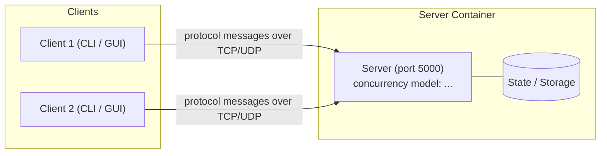

# ExamLink — TCP-Based Online Exam System

> **Course:** Network Programming (INT1433) · PTIT · Instructor: Dr. Hung N. Dang
>
> *An online exam system with JavaFX clients for candidates and proctors, a Java TCP socket server, and automatic session recovery with saved answers after connection loss.*

👋 **New here? Read first:** [`docs/student-guide.md`](docs/student-guide.md) · 📜 Brief & grading: [`INSTRUCTION.md`](INSTRUCTION.md) · 🚀 Workflow: [`GETTING_STARTED.md`](GETTING_STARTED.md)

> **Template note:** replace every *(italic placeholder)* below. Sections marked **(mandatory)** are required for grading.

---

## 1. Team (mandatory)

| # | Full name | Student ID | Class | GitHub | Role |
|:-:|-----------|:----------:|:-----:|--------|------|
| 1 | Trịnh Quang Huy | B23DCCN410 | D23CNPM02 | @zindo511 | Team leader |
| 2 | Nguyễn Thanh Bằng | B23DCCN066 | D23CNPM05 | @bang066123 | Member |
| 3 | Trịnh Minh Đức | B23DCCN192 | D23CNPM05 | @mduckkkk | Member |

**Topic:** Online exam system over TCP with session recovery after connection loss (Java Socket)

---

## 2. Problem & Idea (mandatory)

- **Problem:** When the connection drops during an online exam, candidates cannot tell whether their answers were saved or whether their submission went through, and proctors have a hard time tracking incidents.
- **Our idea:** A JavaFX application for both candidates and proctors that connects to the server over TCP sockets using a custom protocol, with **length-prefix framing** to delimit messages. The server keeps each exam session independent of the underlying connection, so it can restore saved answers on reconnect while keeping the original exam deadline unchanged. Clients with the **PROCTOR** role can monitor candidates' status, and a **heartbeat (PING/PONG)** detects lost contact based on a timeout threshold.
- **What makes it non-trivial:** Assembling and splitting messages from the TCP byte stream; serving many clients concurrently; handling duplicate requests and avoiding conflicts between saving answers, submitting, time expiry and reconnecting.
- **MVP scope / Out of scope:** Sessions are kept in RAM only. Not supported yet: database persistence, recovery after a server restart, web UI, webcam proctoring.

Full proposal: [`docs/proposal.md`](docs/proposal.md)

---

## 3. Features

- [ ] **Connection & session:** *(handshake, authentication, ...)*
- [ ] **Custom protocol:** specified in [`docs/protocol-design.md`](docs/protocol-design.md)
- [ ] **Concurrency:** many clients at once, thread-safe shared state
- [ ] **Robustness:** abrupt disconnects, malformed messages, timeouts
- [ ] **Feature A:** *(short description)*
- [ ] **Feature B:** *(short description)*

---

## 4. Architecture



| Aspect | Our choice | Why (one line) |
|--------|-----------|----------------|
| Language | | |
| Transport | TCP / UDP | |
| Framing | delimiter / length-prefix / fixed | |
| Concurrency model | thread-per-client / thread pool / event loop | |

Details: [`docs/architecture.md`](docs/architecture.md)

---

## 5. Quick Start

```bash
cp .env.example .env          # or: make init
docker compose up --build -d  # start the server   (or: make up)
docker compose run --rm client  # start a client — repeat in more terminals (or: make client)
docker compose down           # stop everything    (or: make down)
```

*(Add any extra steps, e.g., running a GUI client natively.)*

---

## 6. Demo & Test Evidence

*(Screenshots or terminal output of: several clients at once, abrupt disconnect handling, your concurrency test.
Put images in `docs/asset/`. Full results: [`docs/testing-guide.md`](docs/testing-guide.md).)*

---

## 7. Documentation

| Document | Content |
|----------|---------|
| [`docs/proposal.md`](docs/proposal.md) | M1 — problem, idea, scope, plan |
| [`docs/protocol-design.md`](docs/protocol-design.md) | Application-layer protocol specification |
| [`docs/architecture.md`](docs/architecture.md) | Concurrency model, components, connection lifecycle |
| [`docs/testing-guide.md`](docs/testing-guide.md) | Test methods and our test evidence |
| [`docs/ai-log.md`](docs/ai-log.md) | AI usage log |

---

## 8. AI Disclosure (mandatory)

> Policy: [`INSTRUCTION.md` §7](INSTRUCTION.md#7-ai-usage-policy). Disclosing AI use never lowers your score — hiding it does.

### 8.1 Summary

| Tool / model | Used by | Used for | Files / modules | Level |
|--------------|---------|----------|-----------------|-------|
| *(e.g., Claude)* | *(member)* | *(e.g., draft protocol table, review locking code)* | *(paths)* | *(Assist / Co-write / Generated)* |

**Levels:** **Assist** — explanations, suggestions, review; we wrote the code. **Co-write** — AI drafted parts, we
substantially rewrote. **Generated** — AI wrote most of it; we reviewed, tested and can explain it.

### 8.2 Decisions we made ourselves

*(Key design decisions made by the team, possibly after comparing AI-suggested options. E.g., "Chose length-prefixed
framing over newline-delimited because file chunks may contain `\n`.")*

### 8.3 Where AI was wrong — and how we found out

*(At least one concrete example: a bug, wrong assumption or bad design from AI, and how you detected and fixed it.)*

### 8.4 Full log

See [`docs/ai-log.md`](docs/ai-log.md).

---

## 9. Contribution (mandatory)

| Member | Owns (modules / documents) | Key PRs / commits | AI-assisted parts | Contribution % |
|--------|----------------------------|-------------------|-------------------|:--------------:|
| | *(e.g., `server/src/session/`, `docs/architecture.md`)* | *(e.g., #3, #7)* | *(e.g., protocol parser — Co-write)* | |
| | | | | |
| | | | | |

We confirm the table above is accurate and agreed by all members:

- [ ] Member 1
- [ ] Member 2
- [ ] Member 3

---

<sub>Based on the [network-programming-starter](https://github.com/hungdn1701/network-programming-starter) template by Hung N. Dang.</sub>
